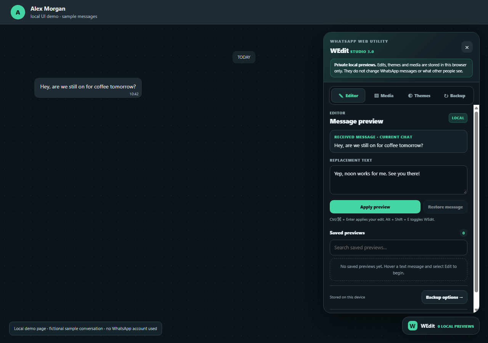
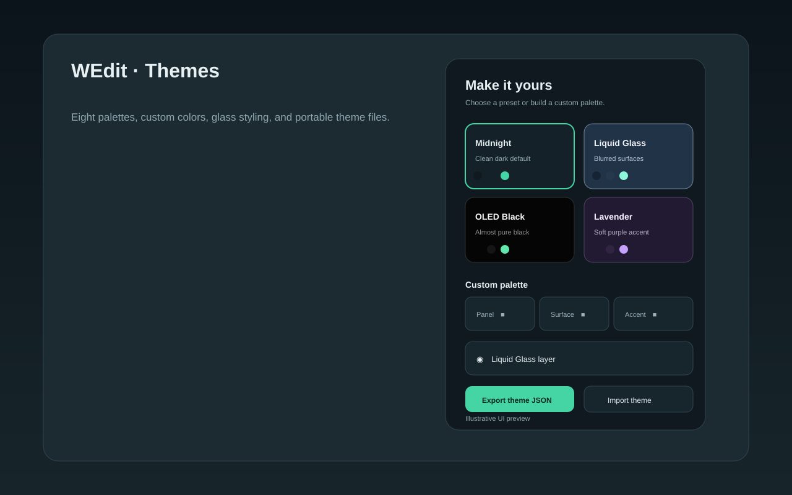
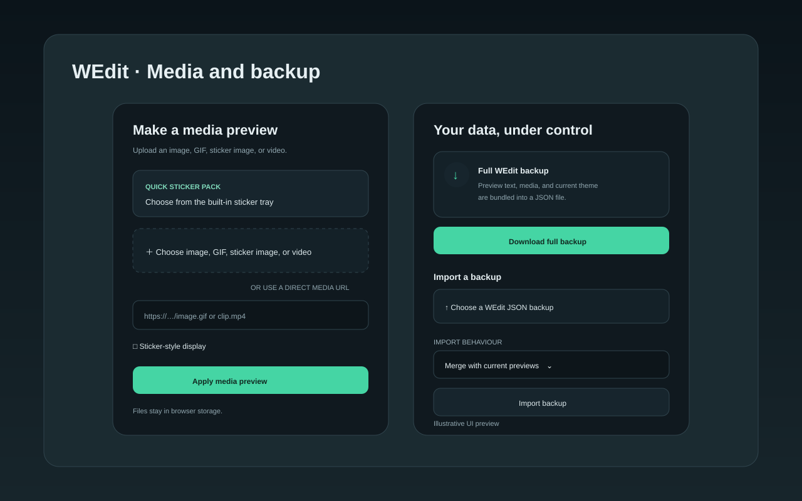

# WEdit — WhatsApp Local Preview Editor

> A no-AI preview studio for WhatsApp Web. Message previews, stickers, themes, and backups stay in your browser; announcements use a separate keyed publisher.



WEdit changes the visible page in your browser. It does not send messages, change WhatsApp's servers, or change what another person sees. There is no AI, account, analytics, or message-sync service. The News tab reads a public feed. Publishing sends only the announcement fields and the entered key to the configured WEdit publishing function; the function keeps its GitHub token server-side.

## What it does

- Select a loaded text message and create a local replacement preview.
- See a live draft preview and character count; reset the draft to the original text with one click.
- Keep a searchable list of saved previews; restore one message or all previews.
- Attach a local image, GIF, sticker-style image, or video preview, or use a direct HTTP(S) media URL.
- Import saved WhatsApp sticker images in bulk or from a folder, then reuse them from a personal sticker shelf.
- Open to a dashboard with local profile shortcuts, saved-preview/theme/sticker stats, News and Changelog links.
- Drag the WEdit launcher anywhere on screen; its position stays on this device and the panel follows it.
- Choose fourteen themes, adjust a custom palette, enable Liquid Glass, and import/export theme JSON.
- Personalize the local profile card with a name, number label, and photo; use **Open profile** for WhatsApp's own profile controls.
- Export or import a full JSON backup, including saved previews, the selected theme, profile card, and uploaded media.
- Use Quick hide to restore original message text and hide all WEdit controls instantly; toggle it with **Alt+Shift+H**.
- Read the in-panel changelog and public announcements; optional interface sounds are controlled by a toggle.
- Toggle the panel with **Alt+Shift+E**. The editor also advertises **Ctrl/⌘+Enter** to apply the current edit.



## Install as a Chrome or Edge extension

### Windows quick launcher

1. Download or clone this repository.
2. Double-click [`install.cmd`](install.cmd). It opens the browser's extension page and this folder.
3. Turn on **Developer mode**.
4. Select **Load unpacked**, then choose the folder containing `manifest.json`.
5. Open or reload [WhatsApp Web](https://web.whatsapp.com/).

The launcher does not bypass Chrome or Edge's extension controls. You complete the **Load unpacked** step in the browser.

### Manual install

- Chrome: open `chrome://extensions/`
- Edge: open `edge://extensions/`

Enable **Developer mode** → **Load unpacked** → select this repository folder.



## Install with Tampermonkey

**New here? Start with the [step-by-step Tampermonkey installation guide](docs/installation.md).** It has direct browser-store links, plain click-by-click steps, advanced setup, troubleshooting, and removal instructions.

Quick install: add Tampermonkey from your browser's official store, then open the [WEdit userscript](https://raw.githubusercontent.com/yoericwsg/wedit-whatsapp-preview/main/wedit.user.js) and click **Install** on the Tampermonkey page. Reload WhatsApp Web.

Tampermonkey checks for script updates on its configured schedule. When a newer version is available, WEdit can also show an in-page notice; click **Update in Tampermonkey**, then **Install**. Each code release must increase the userscript `@version` and `version.json` together.

Tampermonkey asks for permission to contact `raw.githubusercontent.com` so the News tab can read the public announcement feed. No WhatsApp content or local previews are sent with that request.

The same script file is included as `content.js` for the extension build. Tampermonkey and the unpacked extension are two ways to load WEdit; do not enable both at once.

## Package for the Chrome Web Store

Prerequisites: a registered Chrome Web Store developer account and a completed store listing. The store package is separate from this repository bundle.

Run [`package-webstore.cmd`](scripts/package-webstore.cmd). It creates `dist/wedit-web-store.zip` containing the manifest, content script, announcement worker, and icons, with `manifest.json` at the ZIP root. Upload that ZIP from the [Chrome Web Store Developer Dashboard](https://chrome.google.com/webstore/devconsole/), complete the listing and privacy fields, and submit it for review. Store submissions need listing images and a screenshot. The PNG above shows the WEdit interface running on a local demo page with fictional sample messages; it is not from a signed-in WhatsApp account. The SVGs below are illustrative panels.

## Data and privacy

- WEdit stores message preview records and theme settings in the WhatsApp Web origin's local browser storage.
- WEdit stores the profile-card labels/photo and launcher position locally in that same browser profile.
- Uploaded media is stored in IndexedDB under the WhatsApp Web origin.
- A full backup may contain message text and uploaded media. Keep it where you want that data to remain.
- If you enter a media URL, the browser loads that URL to show the preview.
- The News tab requests the public `announcements.json` file from GitHub when opened and every 15 minutes while the tab remains active. This request contains no chat text or preview data.
- Clearing the browser's WhatsApp Web site data may remove local WEdit records and media.
- WEdit does not transmit your edits or backups to a WEdit server.

See [Privacy and storage](docs/privacy-and-storage.md) for details.

## Advanced notes

- Shortcut: **Alt+Shift+E** opens/closes the panel.
- The editor operates on messages currently rendered by WhatsApp Web. Scroll a message into view before selecting it.
- Message selectors and keys depend on WhatsApp Web's page structure; WhatsApp updates can change that structure.
- Local extension development: edit `content.js`, reload WEdit at `chrome://extensions/` or `edge://extensions/`, then reload WhatsApp Web.
- Tampermonkey development: edit `wedit.user.js` and refresh the WhatsApp Web tab.
- Export a backup before moving browser profiles or clearing site data. A restore can merge with the current set or replace it.

See [Installation](docs/installation.md), [Feature guide](docs/features.md), and [Advanced use](docs/advanced-use.md).

The public [changelog](CHANGELOG.md) records releases. The Vercel newsroom displays announcements and release notes; its password-gated admin desk publishes both. The admin password and GitHub token stay server-side; WEdit only reads the public feeds.

### Deploy the WEdit newsroom

This repo contains a public WEdit newsroom at [`index.html`](index.html) and a server-side publisher at [`api/announcements.js`](api/announcements.js). News and release notes are public; only the admin publishing desk requires a password.

1. In Vercel, choose **Add New → Project** and import `yoericwsg/wedit-whatsapp-preview` from GitHub.
2. Keep the project root as the root directory and use the **Other** framework preset. Vercel serves `index.html` and detects the `/api` function automatically.
3. Add these environment variables in **Project Settings → Environment Variables** with **Production only** selected, then redeploy. Do not expose publishing credentials to preview deployments:

- `ADMIN_PASSWORD`: a private password for the newsroom admin desk. Keep it out of source files and public posts.
- `GITHUB_TOKEN`: a fine-grained GitHub token restricted to this repository, with **Contents: Read and write** permission. Store it only in Vercel's environment-variable settings.

Generate a strong password in PowerShell with:

```powershell
$bytes = New-Object byte[] 32
[Security.Cryptography.RandomNumberGenerator]::Fill($bytes)
[Convert]::ToBase64String($bytes)
```

Only share the admin password with people allowed to publish. Do not put either secret in GitHub files or the website bundle. The publisher accepts same-origin requests, validates HTTPS links, versions, and field sizes, keeps the latest 30 announcements, and never returns the GitHub token to the page. The Vercel site shows public announcements and changelog entries; WEdit reads the announcement and changelog JSON feeds directly from GitHub.

## Project files

- `manifest.json` — Manifest V3 metadata and WhatsApp Web match.
- `content.js` — extension content script.
- `background.js` — fetches the public announcement feed for the extension.
- `api/announcements.js` — Vercel function for public news reads and password-protected publishing.
- `index.html` — public newsroom, changelog, and password-gated admin desk.
- `changelog.json` — public release feed used by the site and WEdit.
- `wedit.user.js` — Tampermonkey-ready userscript.
- `announcements.json`, `changelog.json`, and `CHANGELOG.md` — public update feeds and notes.
- `install.cmd` — opens the browser extensions page and repository folder.
- `scripts/package-webstore.cmd` — builds a minimal Web Store ZIP.
- `docs/` — install, feature, privacy, and advanced guides, a local UI demo page, a real interface screenshot, and illustrative panel artwork.

## Contributing

Issues and pull requests are welcome. Keep changes local-first: do not add message sending, tracking, remote storage, or AI processing without clearly changing the product description and privacy documentation.
