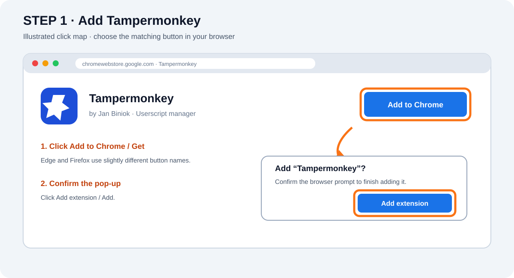
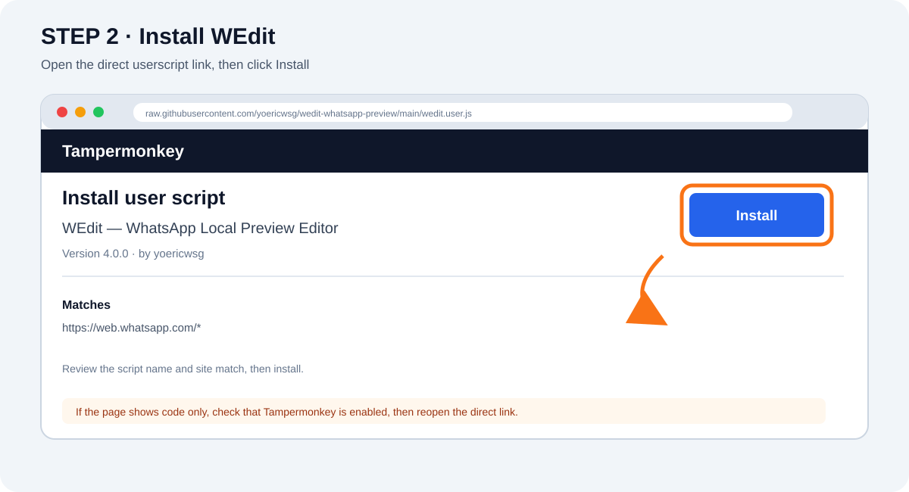
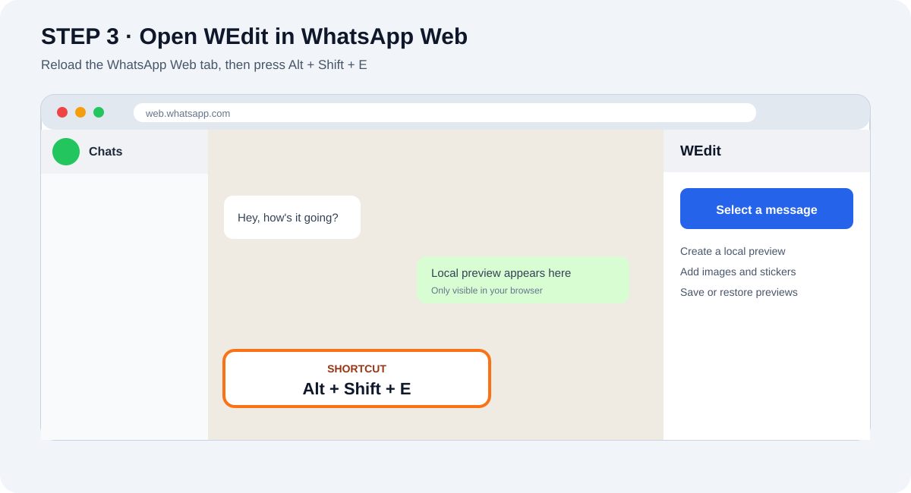

# Install WEdit with Tampermonkey

**This is the easiest way to use WEdit right now.** Install Tampermonkey once, then install WEdit with one click. The extension-store version is a separate option; this guide is for Tampermonkey.

> WEdit creates previews only in your browser. It does not change WhatsApp messages on WhatsApp's servers or change what other people see.

## Before you start

- Use WhatsApp Web in **Chrome** or **Microsoft Edge** on a computer.
- Keep this page open so you can follow each step.
- Install Tampermonkey from your browser's official store:
  - [Install Tampermonkey for Chrome](https://chromewebstore.google.com/detail/tampermonkey/dhdgffkkebhmkfjojejmpbldmpobfkfo)
  - [Install Tampermonkey for Microsoft Edge](https://www.tampermonkey.net/index.php?browser=edge)
  - [Install Tampermonkey for Firefox](https://addons.mozilla.org/en-US/firefox/addon/tampermonkey/)

## Step 1 — Add Tampermonkey to your browser

1. Click the link for your browser above.
2. On the Tampermonkey store page, click **Add to Chrome** or **Get** / **Add to Firefox**.
3. Confirm by clicking **Add extension** or **Add** in the small browser pop-up.
4. Wait for the confirmation that Tampermonkey was added.

**Can’t see the Tampermonkey icon?** Click the puzzle-piece **Extensions** button near the address bar. You can pin Tampermonkey from that menu. Pinning is optional; it just makes the icon easier to find.

## Step 2 — Install WEdit

1. Click this direct link: [Install WEdit userscript](https://raw.githubusercontent.com/yoericwsg/wedit-whatsapp-preview/main/wedit.user.js).
2. Tampermonkey opens a page showing the WEdit script details.
3. Click **Install** near the top of that page.
4. Wait until the installation page closes or shows that WEdit is installed.

### If you see code instead of an Install button

1. Check that Tampermonkey is enabled in your browser's Extensions menu.
2. Open the direct WEdit link again: [wedit.user.js](https://raw.githubusercontent.com/yoericwsg/wedit-whatsapp-preview/main/wedit.user.js).
3. If it still shows plain code, open Tampermonkey → **Dashboard** → **Utilities** → **Import from URL**, paste the direct link above, and choose **Install**. If your Tampermonkey version does not show **Import from URL**, use **Create a new script**, replace the starter text with the contents of the linked file, and save with **Ctrl+S**. A script installed by copy/paste may not receive automatic updates; reinstall from the direct link when convenient.

## Step 3 — Open WEdit

1. Open [WhatsApp Web](https://web.whatsapp.com/) and sign in as usual.
2. If WhatsApp Web was already open, reload the tab with **Ctrl+R**.
3. Open WEdit with **Alt+Shift+E**. On some keyboards, hold **Alt** and **Shift**, then tap **E**.
4. To close the WEdit panel, press **Alt+Shift+E** again.

## Updates

After the first install, Tampermonkey checks for WEdit script updates automatically on its update schedule. When a release is available, Tampermonkey can install it without you repeating the setup. To check immediately, open the Tampermonkey menu and choose **Check for WEdit updates**. If WEdit shows an update notice inside WhatsApp Web, click **Update in Tampermonkey**, then click **Install** on the page that opens.

## Common fixes

| What you see | Try this |
| --- | --- |
| Tampermonkey store says it is already installed | Continue to Step 2. |
| WEdit does not appear in WhatsApp Web | Open Tampermonkey → **Dashboard** and make sure WEdit is enabled; then reload WhatsApp Web. |
| The shortcut does nothing | Click the WhatsApp Web tab once, then press **Alt+Shift+E**. You can also open WEdit from the Tampermonkey menu if it is listed there. |
| The Tampermonkey menu says WEdit is not running | Confirm the address is `web.whatsapp.com`, enable the WEdit script in the dashboard, and reload the page. |
| Both the extension and userscript are installed | Turn one off in its browser settings; running both can create two panels. |

## Remove WEdit

1. Open Tampermonkey → **Dashboard**.
2. Find **WEdit — WhatsApp Local Preview Editor**.
3. Turn it off with its toggle, or open it and click the delete/trash control.

To erase saved WEdit previews and media too, clear the browser's site data for `web.whatsapp.com`. This also clears other WhatsApp Web site data.

## Visual guide note

The images on this page are labeled illustrations of the buttons and locations. Store layouts can shift slightly between browser versions and languages; follow the bold button names if your screen looks a little different.
